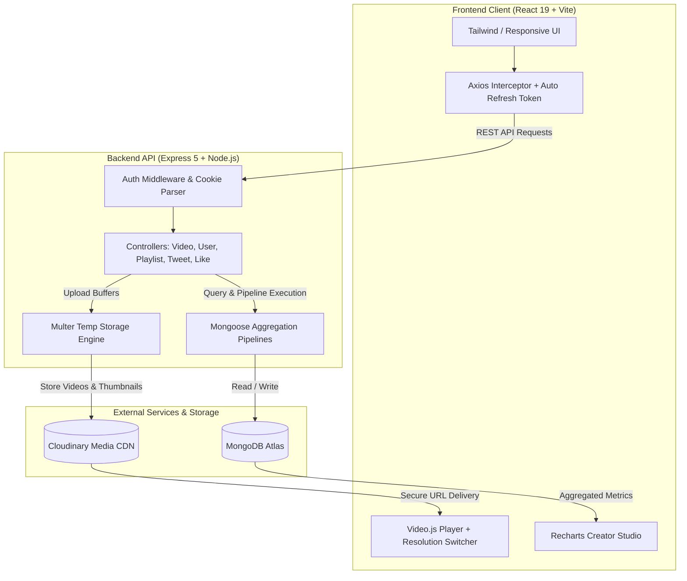
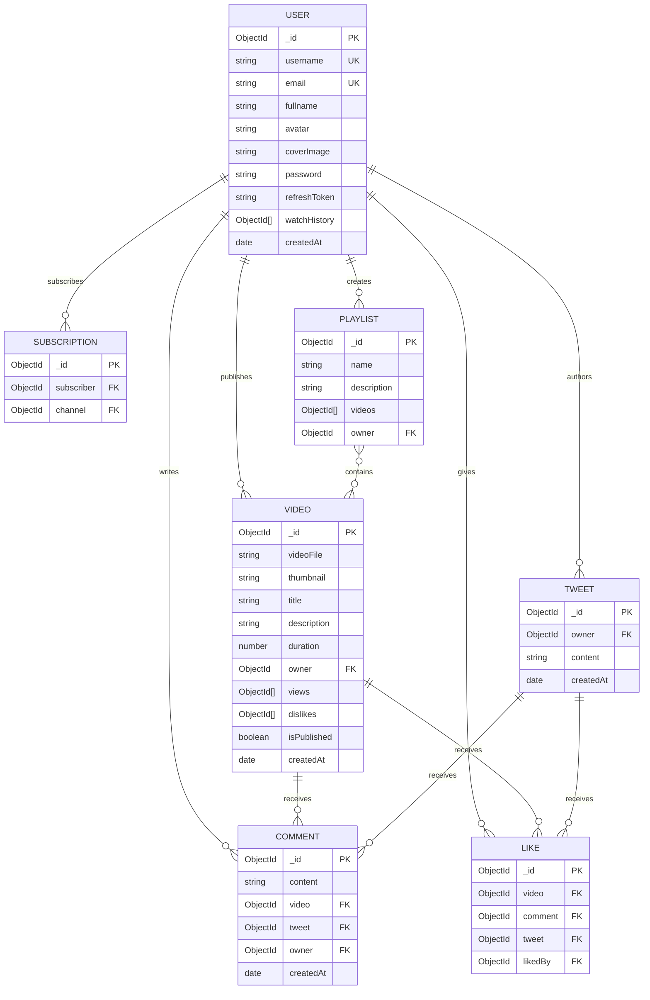

# 🎬 YarnTV — Full-Stack Video Sharing & Creator Platform

<div align="center">


**A high-performance, full-stack video streaming, creator community, and content delivery network powered by Node.js, Express, MongoDB, and React.**

[](https://opensource.org/licenses/ISC)
[](https://nodejs.org/)
[](https://expressjs.com/)
[](https://react.dev/)
[](https://vitejs.dev/)
[](https://www.mongodb.com/)
[](https://cloudinary.com/)

[Key Features](#-key-features) •
[System Architecture](#-system-architecture) •
[Tech Stack](#-tech-stack) •
[Database Schemas](#-database-schemas) •
[API Reference](#-api-reference) •
[Getting Started](#-getting-started) •
[Upcoming Roadmap](#-upcoming-roadmap)

</div>

---

## 📌 Executive Summary

**YarnTV** is a scalable, end-to-end video streaming and creator ecosystem designed to mimic enterprise platforms like YouTube. Engineered with a decoupled client-server architecture, it pairs an **Express 5** REST backend featuring complex **MongoDB aggregation pipelines** and **Cloudinary** media storage with a reactive **React 19** frontend featuring **Video.js** multi-resolution playback, real-time analytics with **Recharts**, community tweets, and secure dual-token JWT authentication.

---

## ✨ Key Features

### 🎥 Media Processing & Streaming
- **Multi-Asset Uploads**: Concurrent file processing via `Multer` with cloud offloading to `Cloudinary` for video files, high-res thumbnails, avatars, and channel banners.
- **Adaptive Multi-Resolution Playback**: High-performance video player powered by `@videojs/react` with dynamic resolution switching (`videojs-resolution-switcher`).
- **View Counter & Watch History**: Tracking of unique views and automated user watch history pipelines.

### 👤 Authentication & Channel Management
- **Enterprise Dual-Token JWT**: Access tokens (short-lived) and Refresh tokens (long-lived) securely stored in HTTP-Only cookies with silent background token refresh interceptors.
- **Channel Customization**: Editable usernames, emails, channel bio, avatar image, and cover banners.
- **Subscriber Engine**: Follow/subscribe mechanism with real-time subscriber counts and subscriber channel feeds.

### 💬 Social & Community Engagement
- **Interactive Engagements**: Like and dislike toggles for videos, comments, and community tweets.
- **Nested Discussions**: Commenting system with full CRUD support on videos and community posts.
- **Creator Tweets (Community Wall)**: Text-based microblogging feed for creators to announce updates, polls, and milestones.
- **Playlists**: Custom playlist creation, public/private toggling, and video curation.

### 📊 Creator Studio & Admin Dashboard
- **Analytics at a Glance**: Visual analytics charts powered by `Recharts` showcasing video view velocity and subscriber growth curves.
- **Content Governance**: One-click publish/unpublish toggling, metadata updates, and cascading asset deletion.

---

## 🏗️ System Architecture



---

## 🛠️ Tech Stack

| Layer | Technologies | Purpose |
| :--- | :--- | :--- |
| **Frontend Framework** | React 19, Vite 8, React Router v7 | Blazing-fast SPA rendering & client-side routing |
| **Video Player** | Video.js, `@videojs/react`, `videojs-resolution-switcher` | Smooth multi-bitrate video streaming playback |
| **Data Visualization**| Recharts | Creator metrics, subscriber history & performance charts |
| **HTTP Client** | Axios (with token rotation interceptor) | Seamless API connectivity & automatic re-authentication |
| **Backend Framework** | Node.js, Express.js (v5) | Modular RESTful architecture |
| **Database** | MongoDB Atlas, Mongoose (v9) | Document database with aggregation pagination |
| **Media Storage** | Cloudinary SDK, Multer | Media asset transcoding, storage, and global CDN delivery |
| **Security & Auth** | JWT (JSON Web Tokens), Bcrypt, Cookie-Parser | Password hashing, secure HTTP-only cookies, token rotation |

---

## 🗄️ Database Schemas

The database leverages relational references and complex aggregation stages to provide lightning-fast lookups:



---

## 🔌 API Reference

### Base URL: `/api/v1`

#### 👤 User & Authentication (`/user`)
| Method | Endpoint | Access | Description |
| :--- | :--- | :--- | :--- |
| `POST` | `/register` | Public | Register new user with avatar & cover image |
| `POST` | `/login` | Public | Authenticate user & issue Access/Refresh tokens |
| `GET` | `/logout` | Authenticated | Invalidate refresh token & clear cookies |
| `GET` | `/refresh-token` | Public | Refresh expired access tokens using refresh token |
| `GET` | `/curr-user` | Authenticated | Retrieve current session user payload |
| `PATCH` | `/change-password` | Authenticated | Update existing user password |
| `PATCH` | `/edit-account` | Authenticated | Update username and email |
| `PATCH` | `/edit-avatar` | Authenticated | Upload new channel avatar |
| `PATCH` | `/edit-coverImage` | Authenticated | Upload new channel banner |
| `GET` | `/profile/:username` | Authenticated | Fetch public channel profile with subscription stats |
| `DELETE` | `/deleteAccount` | Authenticated | Permanently delete account and associated credentials |

#### 🎥 Videos (`/video`)
| Method | Endpoint | Access | Description |
| :--- | :--- | :--- | :--- |
| `GET` | `/get-feed-videos` | Public | Paginated home video feed |
| `GET` | `/watch-video/:video_id` | Public / Optional | Fetch video stream details, increment views |
| `POST` | `/create-video` | Authenticated | Upload video file and thumbnail to Cloudinary |
| `PATCH` | `/update-video/:videoId`| Authenticated | Modify video title, description, and status |
| `DELETE` | `/delete-video/:videoId`| Authenticated | Delete video document and Cloudinary asset |
| `GET` | `/get-user-videos/:username` | Authenticated | List videos uploaded by specific creator |
| `POST` | `/search-video/:title`| Public / Optional | Full-text search on feed videos |
| `GET` | `/get-liked-videos` | Authenticated | Fetch library of videos liked by the user |
| `GET` | `/get-watched-videos` | Authenticated | Retrieve user watch history |
| `GET` | `/get-admin-videos` | Authenticated | List videos for creator studio management |
| `GET` | `/get-admin-stats` | Authenticated | Fetch channel metrics (views, subscribers, total likes) |

#### 📝 Community & Tweets (`/tweet`)
| Method | Endpoint | Access | Description |
| :--- | :--- | :--- | :--- |
| `POST` | `/create-tweet` | Authenticated | Publish a community post |
| `GET` | `/get-feed-tweets` | Authenticated | Feed of community posts from followed creators |
| `GET` | `/get-user-tweets/:user_id` | Authenticated | Creator-specific community posts |
| `DELETE` | `/delete-tweet/:tweet_id` | Authenticated | Remove community post |

#### 👍 Likes & Interactions (`/like`)
| Method | Endpoint | Access | Description |
| :--- | :--- | :--- | :--- |
| `GET` | `/video/:video_id` | Authenticated | Toggle like on a video |
| `GET` | `/tweet/:tweet_id` | Authenticated | Toggle like on a tweet |
| `GET` | `/comment/:comment_id` | Authenticated | Toggle like on a comment |

#### 📂 Playlists (`/playlist`)
| Method | Endpoint | Access | Description |
| :--- | :--- | :--- | :--- |
| `POST` | `/create-new-playlist/:video_id` | Authenticated | Create a playlist and add initial video |
| `GET` | `/get-user-playlists/:user_id` | Authenticated | Fetch user's public playlists |
| `GET` | `/get-playlist-videos/:playlist_id`| Authenticated | Retrieve all videos inside a playlist |
| `GET` | `/save-video-playlist/:playlist_id/:video_id` | Authenticated | Add video to existing playlist |
| `DELETE` | `/delete-video-playlist/:playlist_id/:video_id` | Authenticated | Remove video from playlist |
| `DELETE` | `/delete-playlist/:playlist_id` | Authenticated | Delete entire playlist |

---

## 🚀 Getting Started

### Prerequisites
- **Node.js**: v18.0.0 or higher
- **npm** or **pnpm** / **yarn**
- **MongoDB**: Local instance or MongoDB Atlas connection string
- **Cloudinary Account**: Cloud name, API key, and API secret

---

### Installation & Local Setup

#### 1. Clone the repository
```bash
git clone https://github.com/swarnavachakraborty2-hash/FULLSTACK-YarnTV.git
cd FULLSTACK-YarnTV
```

#### 2. Backend Configuration
Navigate to the backend directory and install dependencies:
```bash
cd backend
npm install
```

Create a `.env` file in `/backend`:
```env
PORT=5000
DATABASE_URI=mongodb+srv://<username>:<password>@cluster.mongodb.net/videotube?retryWrites=true&w=majority
CORS_ORIGIN=http://localhost:5173

# JWT Configuration
ACCESS_TOKEN_SECRET=your_super_secret_access_token_key_32_characters_long
ACCESS_TOKEN_EXPIRY=1d
REFRESH_TOKEN_SECRET=your_super_secret_refresh_token_key_32_characters_long
REFRESH_TOKEN_EXPIRY=10d

# Cloudinary Storage
CLOUDINARY_CLOUD_NAME=your_cloudinary_name
CLOUDINARY_API_KEY=your_cloudinary_api_key
CLOUDINARY_API_SECRET=your_cloudinary_api_secret
```

Start the backend server in development mode:
```bash
npm run dev
# Server runs on http://localhost:5000
```

#### 3. Frontend Configuration
In a new terminal, navigate to the frontend directory:
```bash
cd ../frontend
npm install
```

Create a `.env` file in `/frontend`:
```env
VITE_API_URL=http://localhost:5000/api/v1
```

Start the Vite development server:
```bash
npm run dev
# Frontend runs on http://localhost:5173
```

---

## 🔮 Upcoming Roadmap

We are actively engineering future enhancements to expand StreamPulse into an all-in-one educational and creator live ecosystem:

### 🔴 Phase 1: Real-Time Live Streaming Engine
- **WebRTC & RTMP Ingestion**: Low-latency live broadcast streaming directly from the browser or OBS Studio.
- **HLS / DASH Adaptive Transcoding**: Live segment chunking with dynamic bitrates for smooth mobile and desktop playback.
- **Live Stream Live Chat**: WebSocket-powered (`Socket.IO`) real-time live chat with moderation filters, slow mode, and super chats.
- **VOD Archival**: Automated conversion of completed live streams into on-demand videos saved directly into creator libraries.

### 📄 Phase 2: Document & Digital Resource Uploads
- **Educational Asset Attachments**: Upload and bind lecture notes, source code archives, slides, and cheat sheets (PDF, DOCX, ZIP) directly to video tutorials.
- **In-Browser Document Viewer**: Built-in PDF reader allowing viewers to follow along with course documentation side-by-side with the video player.
- **Resource Download Governance**: Role-based access control (public vs. subscriber-only document downloads) with virustotal scanning integrations.

### ⚡ Phase 3: Platform Hardening & Scalability
- **Redis Caching Layer**: Cache frequent queries (trending videos, top creator profiles) to decrease database load.
- **Microservice Video Transcoding**: Offload background video processing via AWS S3 + AWS Elemental MediaConvert / FFmpeg worker queues.
- **Elasticsearch Integration**: Distributed multi-facet search engine for instantaneous video, creator, and document discovery.

---

## 🔒 Security & Best Practices

- **Zero-Storage Passwords**: Passwords hashed using `Bcrypt` with salt rounds prior to persistence.
- **XSS & CSRF Mitigation**: Access and refresh tokens dispatched over secure, `HttpOnly`, `SameSite=Strict` cookies.
- **Strict Payload Throttling**: Express-level JSON and URL-encoded limits pinned to `16kb` to prevent Denial-of-Service attacks.
- **Safe Media Lifecycles**: Multer streams files temporarily to local temp storage before securely uploading to Cloudinary and unlinking local files.

---

## 🤝 Contributing

Contributions make the open-source community an incredible place to learn, inspire, and create. Any contributions you make are **greatly appreciated**.

1. Fork the Project
2. Create your Feature Branch (`git checkout -b feature/AmazingFeature`)
3. Commit your Changes (`git commit -m 'Add some AmazingFeature'`)
4. Push to the Branch (`git push origin feature/AmazingFeature`)
5. Open a Pull Request

---

## 📜 License

Distributed under the ISC License. See `LICENSE` for more information.

---

## 👨‍💻 Author

**Swarnava Chakraborty**
- GitHub: [@swarnavachakraborty2-hash](https://github.com/swarnavachakraborty2-hash)
- Repository: [FULLSTACK-YarnTV](https://github.com/swarnavachakraborty2-hash/FULLSTACK-YarnTV)

<div align="center">
  <sub>Built with ❤️ for creators and streamers worldwide.</sub>
</div>
